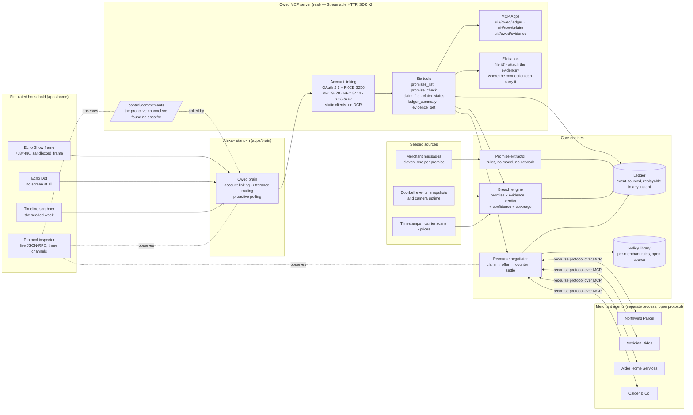
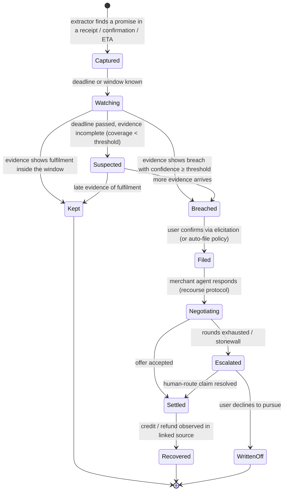
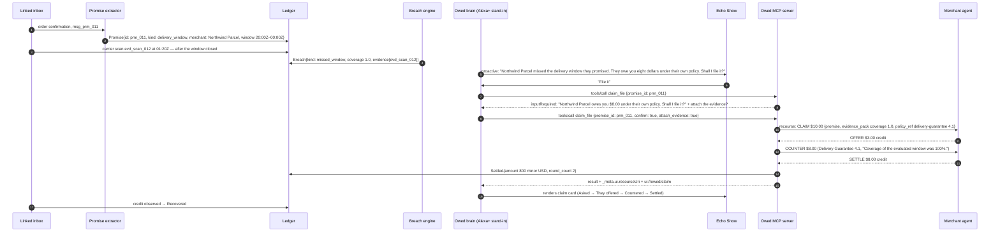

# Owed — the Alexa+ add-on that works for the customer, not the brand

> **"Alexa, what am I owed?"**
> Owed records every promise a business makes to your household — a delivery window, a ride ETA, a refund SLA, a guarantee — notices when it's broken, and collects what you're owed by negotiating with the merchant's agent. You never lift a finger.

Built for **Build, Ship, Shape: Amazon Developer Hackathon 2026** — Alexa+ primary track, AWS Builder and Open Source mini-challenges.

---

## 1. Thesis

Every Alexa+ add-on shipped so far exists so a *brand* can reach a customer. The Alexa+ store is a distribution channel. Owed is the inversion: an add-on whose principal is the **household**, sitting on the customer's side of every transaction those brands run through Alexa.

- **Before** a transaction: nothing to do — you buy, ride, book as usual.
- **During**: Owed captures the promise at the moment it is made (from receipts, confirmations, ETAs).
- **After**: Owed detects the breach with evidence, files the claim, and settles it agent-to-agent with the merchant's agent.

Businesses price in the fact that almost nobody claims. Owed removes the effort, so the breakage comes home.

**Why it belongs in Alexa+:** the design guide asks that an add-on "do at least one thing better because it lives in Alexa+". The promise is captured *in the conversation where it is made*, and the outcome is spoken back in the room where the household lives. Amazon reports customers engage 6× more with integrated services; that only scales if the customer trusts the agent's transactions. Owed is the consumer-side accountability layer — the mirror image of Amazon Wallet.

---

## 2. What the judge sees (90-second storyboard)

*Every beat below is asserted by [`scripts/verify-ui.mjs`](scripts/verify-ui.mjs), which
drives this exact sequence in a real Chrome and checks the numbers on the cards. The
figures here are the figures it reads.*

*These are the beats, at the pace the automated check drives them.
[`docs/demo-script.md`](docs/demo-script.md) is the same sequence as a recorded take —
the same beats in the same order, with narration, an opening framing of the problem and a
closing pass over the published numbers, which is why it lands at 2:58 rather than 1:30.
One is the test, the other is the script, and `pnpm verify:docs` now checks that the script's
hypothesis verdicts match what the harnesses found — because this line used to claim neither
was stale, while the script spent eleven days telling a reader to say "breach detection: not
met" after a fix made it met.*

| t | Surface | What happens |
|---|---|---|
| 0:00 | Echo Show (Sun 19:30) | *"Alexa, what am I owed?"* → **Recovered this week $47.00 · Still open $8.00 · 2 kept.** Spoken: "You've recovered forty-seven dollars this week, and eight dollars is still open. Two promises were kept. There's one I'm not claiming, because I only watched twenty percent of the window. There's one more I can file." |
| 0:15 | Echo Show | *"Why aren't you claiming that?"* → the evidence card. A coverage bar with the unwatched stretches **cut out where they actually fell**, the verdict *not enough to claim*, and — quoted under **they wrote** — the merchant's own sentence the promise was read out of. |
| 0:30 | Timeline scrubber | The judge drags back to Monday and forward across the week. Every tool answers for the clock, so the ledger empties and refills as they scrub. |
| 0:45 | Echo Show | Crossing Sunday evening, **Owed speaks first**, badged `simulated proactive`: "Northwind Parcel missed the delivery window they promised. They owe you eight dollars under their own policy. Shall I file it?" The inspector shows the `CommitmentEvent` on its own channel — the shape we designed for, because the published docs describe no such channel. |
| 1:00 | Echo Show | *"File it."* → **Asked · They offered · Countered · Settled**, at **$8.00**. The counter cites **Delivery Guarantee 4.1** — the merchant's own published clause. |
| 1:10 | Protocol inspector | The argument itself, on the wire: `tools/call claim_file`, then the recourse exchange with Northwind Parcel's agent nested inside it, then the result that argument produced. Sorted into causal order, not arrival order. |
| 1:20 | Echo Dot | Same questions, **no screen at all**. The answers still stand on their own, which is the only honest way to show voice-only parity. |
| 1:30 | Close | "Alexa+ will have hundreds of add-ons that sell to you. This is the one that represents you." |

---

## 3. System architecture

*This is what exists. Everything the ideation proposed and we did not build is listed in
§13, by name.*



**Real:** the MCP server and everything under it — Streamable HTTP, the OAuth authorization
server, the six tools, the three `ui://` views, elicitation, the event-sourced ledger, the
breach engine, the rule extractor, the negotiator, and the merchant agents, which run in
their own process and are argued with over HTTP rather than called in-process.

**Simulated, and labelled as such wherever it appears:** the Alexa+ orchestrator, NLU and
voice pipeline; proactive delivery, because the published add-on documentation describes no
such channel and we could not find one; the device frames; and the household's evidence
sources, which are seeded rather than live.

---

## 4. Promise lifecycle



Every transition is an event in the ledger. The card and the "recovered this week" number are projections of the event log.

---

## 5. Sequence — the claim the demo files

Not an illustration. This is `clm_prm_011`, the claim the storyboard files at 0:45, and
every id, instant and amount below is re-derivable from
[`docs/demo-capture.json`](docs/demo-capture.json) — which `pnpm verify:ui` asserts against
what the browser renders. An earlier version of this diagram was invented: it showed a
`phantom_delivery` the recorded week does not contain, a `claim.file` tool that has never
existed under that name, and amounts in rupees.

**And the recording can be re-derived rather than trusted:** `node scripts/capture-demo.mjs
--check` boots the server and the merchant agents again, walks OAuth again, drives the same
tools again, and compares what it sees to the committed file in memory without writing it —
the same `--check` idiom `draw-architecture.mjs` uses, for the same reason. Everything is
compared except `captured_at`, `commit` and the wall-clock instants stamped on observed
frames. That mattered: the capture committed before 2026-10-21 had gone 41 commits without
being re-derived, and the re-run found its recorded `ledger_summary` output schema missing the
`watched` field added since. Every figure, spoken line, claim id and negotiation round in it
was still exactly right.



The `policy_ref` on the wire is the full `northwind/delivery-guarantee#4.1`; the diagram
drops the `#` because mermaid reads it as the start of an entity escape.

The ask is the clause's **ceiling** and the counter is its **reservation** — Owed opens at
the most the published policy allows and will not go below the least it allows, which is
why a merchant's $3.00 opening offer is refused and $8.00 is where it lands — it accepts a
standing offer only at or above the reservation, and otherwise counters at exactly it. §8
has the negotiator.

---

## 6. MCP surface (the real add-on contract)

Server: TypeScript, `@modelcontextprotocol/server` 2.x, **Streamable HTTP**, protocol **2025-11-25 or later**, stateless request handling with ledger-backed state. A client that asks for nothing — the brain, and Alexa+ — negotiates 2025-11-25, which `alexa/contract.test.ts` reads off the transport; one that asks for auto negotiation gets 2026-07-28, which is what `docs/demo-capture.json` records, and §6.2 explains why the demo stays on the earlier revision. Target tool latency < 500 ms (breach detection runs async; tools read state).

### 6.1 Account linking
OAuth 2.1 + PKCE (S256), discovery via RFC 9728 (protected resource metadata) and RFC 8414 (AS metadata), audience binding via RFC 8707, loopback redirects per RFC 8252. Owed runs **its own authorization server** — the MCP SDK ships none — and the brain walks the real authorization-code flow rather than being handed a token out of band.

**Static clients, no dynamic registration.** Amazon's documentation says Alexa+ does not support RFC 7591, so the server does not offer it: a client is configured in advance or it does not link. Passes the community conformance checker on every documented check, run inside `pnpm verify`
against a real booted server. The checker is the `mcp-voice-simulator-conformance` binary of
the **`mcp-voice-simulator`** package (0.2.2) — so `npx mcp-voice-simulator-conformance`,
which is what this line used to say, 404s: npx resolves a package name, and that is the name
of a binary. `npx -p mcp-voice-simulator mcp-voice-simulator-conformance <url>` is the form
that works, and `pnpm conformance` is the form that needs no arguments.

### 6.2 Tools

Names are as registered — **snake_case**, which is what a client calls and what the
inspector shows. Inputs and outputs are the zod schemas in `packages/mcp-server/src/tools/`
and `packages/domain/src/views.ts`, not a paraphrase of them; `schemas.sync.test.ts` pins
the parts that are declared twice.

| Tool | Input | Output | UI |
|---|---|---|---|
| `ledger_summary` | `{period?: "week"\|"month"}` | `LedgerSummaryView`: `{currency, recovered, open, kept, declined, items[], period, as_of}` | `ui://owed/ledger` |
| `promises_list` | `{status?: PromiseStatus, merchant?: string}` | `LedgerSummaryView`, filtered — the same shape, so one card renders both | `ui://owed/ledger` |
| `promise_check` | `{promise_id}` | `EvidenceView`: `{status, verdict?, coverage?, gaps[], promised_in?, explanation?, items[]}` | `ui://owed/evidence` |
| `claim_file` | `{promise_id, confirm?: boolean, attach_evidence?: boolean}` | `ClaimView`: `{claim_id, state, ask, expected, settled_amount?, recovered_amount?, rounds[], round_count}` — or an `inputRequired` asking for the household's yes | `ui://owed/claim` |
| `claim_status` | `{claim_id}` | `ClaimView` | `ui://owed/claim` |
| `evidence_get` | `{evidence_id, promise_id}` | `EvidenceView` | `ui://owed/evidence` |

`confirm` is the whole consent mechanism and was missing from this table: nothing is filed
without it, and where a client cannot be asked — a 2025-revision connection with no
elicitation capability — it is the *only* way to say yes. `evidence_get` needs the
`promise_id` as well, because an evidence id alone does not say whose promise it belongs to.
Both omissions mattered more than the dotted names: a reader following this table would
have called a tool that does not exist, and then called it wrong.

All tool results carry `content[]` (text fallback for voice-only devices), `structuredContent`, and `_meta.ui.resourceUri` per the Alexa+ client lifecycle. Tool signatures are frozen after v1 (Alexa+ locks them at certification).

### 6.3 MCP Apps (views)
- `ui://owed/ledger` — headline number, three-item list, one action. 768×480 base canvas, root scale for Echo Show 8/15, 1.6 typography ratio, Alexa tokens.
- `ui://owed/claim` — offer → counter → settled timeline; two-column agent transcript, collapsed by default.
- `ui://owed/evidence` — coverage bar ("watched 82% of window"), snapshots, gaps stated explicitly.
Views are sandboxed iframes with CSP; they call back only via `postMessage` (host bridge), never fetch directly.

### 6.4 Elicitation
Form-mode, flat primitives only — which is the whole of what the spec permits. Both of v1's
questions (*file it?* and *attach the doorbell evidence?*) are asked in **one round** rather
than serially; being asked twice about one claim is worse, not better.

Elicitation runs **only where the connection can carry it.** On the 2026-07-28 revision the
request rides in the result and the client retries, so it works under per-request serving. On
the 2025-11-25 revision it is a server-to-client request that needs a session, and per-request
serving cannot make one — so there `claim_file` proposes in words and waits for `confirm`.
Both paths are tested, including decline. See docs/friction-log.md §10–11; the second is an SDK
bug we shipped from its own worked example before a test caught it.

**The demo deliberately takes the `confirm` path.** The brain connects on **2025-11-25**,
the revision Amazon's Alexa+ documentation names, precisely so the demo runs on the
protocol Alexa+ actually speaks — and on that revision, served per-request, elicitation
cannot happen at all. Switching the brain to 2026-07-28 would light up the elicited round
trip on screen and would mean demonstrating a primitive on a revision Alexa+ does not use.
The elicited path is exercised by the contract suite instead, on a modern-era connection,
end to end with a client that answers.

---

## 7. Recourse protocol (open spec, `packages/recourse-protocol`)

Agent-to-agent dispute resolution, MCP-shaped so any merchant agent can implement it as tools.

```
CLAIM    { claim_id, promise, evidence_pack{items[], coverage}, policy_ref, ask }
OFFER    { claim_id, amount, form: credit|refund|reship, terms }
COUNTER  { claim_id, amount, justification{policy_clause, evidence_ids[]} }
SETTLE   { claim_id, amount, form, reference }
DECLINE  { claim_id, reason, escalation_route }
```

Rules: max N rounds (default 3); every message signed with the claim id; evidence is referenced, never re-sent; a `DECLINE` must carry a human escalation route. Negotiator strategy: reservation value from the policy library, concession schedule by merchant type, stop on `SETTLE ≥ reservation` or rounds exhausted.

Merchant agents in `packages/merchant-agents` are configured per merchant *and breach kind*, because that is what is actually true of merchants: Calder & Co. settles its price promise on request and contests its refund timing, from one configuration. The eval harness runs the **full pre-registered grid of 270 policies × 6 breach kinds = 1,620 negotiations**, including merchants that withdraw an offer when countered.

**When no agent answers, the claim is still recorded.** Almost no merchant implements this
protocol, so this is the common case and not the edge one. Owed files the claim anyway —
`ClaimProposed` and `ClaimFiled`, carrying the clause, the published figure and the
evidence, projecting to `Filed` with one round that says it asked and nothing after it —
and tells the household how they will have to pursue it. Where the merchant's own policy
publishes a claims contact the route is `email`; where it publishes nowhere to send it, the
route is `manual` and Owed says so rather than implying otherwise. Before this the branch
returned "I'll keep the claim open" and kept nothing: no events, no claim, and asking again
started from scratch.

---

## 8. Core engines

### 8.1 Promise extractor
Input: a message (receipt / confirmation / ETA notification). Output: typed `Promise`:
```ts
type Promise = {
  id: string; household_id: string; merchant: string; source_ref: string;
  kind: "delivery_window" | "eta" | "refund_sla" | "appointment_slot" | "guarantee" | "price_match" | "warranty";
  made_at: string; window?: { start: string; end: string }; deadline?: string;
  amount_at_stake?: number; currency: string; policy_ref?: string; confidence: number;
};
```
**Rules, not a model** — `packages/extractor`, no network and no AWS. It finds time expressions first and classifies each by the words around it, rather than running seven regexes at the text: "between 1 and 5" is a delivery window, an engineer's visit or a shop's opening hours depending entirely on its neighbours. A cue before the clock beats one after it, and a word that can only mean one thing (engineer, warranty, price match) outranks a generic verb sitting nearer.

Every extraction carries the sentence it was read from. That is not decoration: **the evidence card quotes it**, under "they wrote", so a household can check the promise against the merchant's own words rather than take Owed's reading on trust.

The storyboard's promises stay authored, so the demo is deterministic whatever the extractor does next — but each one now has the message it claims to come from, and [`extraction.test.ts`](packages/mcp-server/src/seed/extraction.test.ts) runs the real extractor over that message and asserts it recovers the promise **to the minute**. The `source_ref` on every promise used to point at nothing.

Measured on 120 labelled messages and, separately, on 40 held out — see §10 and `eval/README.md`. The held-out number is the one that means anything.

### 8.2 Breach engine
`breach = f(promise, evidence[])` → `{kind, confidence, coverage, evidence_ids, explanation}`.
- Coverage = fraction of the promise window observed by any evidence source. Below threshold → `Suspected`, never `Breached`. The card says what was and wasn't seen.
- Breach kinds v1: `late_eta`, `missed_window`, `phantom_delivery`, `no_show`, `late_refund`, `price_drop`.
- Evidence kinds v1: `timestamp`, `carrier_scan`, `doorbell_event`, `doorbell_snapshot`,
  `refund_observed`, `price_observed`. Six, not five: `price_observed` was added at D5
  (`docs/contract-v1.md` §1) because `price_drop` is on the line above and none of the
  original five could carry a price, so that detector had no input to reason over.

### 8.3 Ledger
Append-only and event-sourced (`PromiseCaptured`, `EvidenceObserved`, `PromiseAssessed`, `ClaimProposed`, `ClaimFiled`, `Settled`, `Recovered`, …). Every event carries both `occurred_at`, when the thing happened in the household's week, and `recorded_at`, when Owed learned of it — so the ledger replays to any instant and every tool answers for the clock rather than for now. That is what makes the timeline scrubber truthful rather than cosmetic.

**In memory by default, on disk when you ask.** A demo that reseeds identically every run is worth more than one that drifts, so memory is the default. `OWED_DB=owed.db` swaps in a SQLite store built on Node's own `node:sqlite` — no dependency added — and then the seed is written only if the file is empty, because reseeding a ledger that already holds a week would append a second copy of everything. There is no `UPDATE` and no `DELETE` in that adapter; `seq` is insertion order and is the primary key. Rows are parsed back through the event schema on read, so a stale write or a hand edit is a loud failure rather than a card quietly showing something impossible.

### 8.4 Speaking first (`CommitmentEvent`)
Everything the published add-on documentation describes is reactive: a tool runs because somebody said something. For most add-ons that would be an inconvenience; for Owed it looked like it removed the product, because Owed exists to notice what the household did *not* ask about.

*What that claims, precisely:* we checked the documentation, not the platform. On review we were told the public docs are incomplete here and that a good deal is omitted, so a proactive path may exist and we simply could not find it — we have not verified either way. The consequence was real regardless: a builder who cannot find a capability designs around its absence, and everything proactive in this project is therefore a simulation wearing a `simulated proactive` badge.

So the one primitive we needed was the one we could not find documented, and we wrote it down as a schema rather than a paragraph in a feedback form: **`CommitmentEvent`**, carrying `expires_at` (proactive speech has to be allowed to go stale), `urgency` (only the add-on knows whether money is about to stop being recoverable) and `offer` (without it, an announcement is a dead end).

The server exposes everything Owed would say unprompted as a **projection of the ledger**, not a queue — so scrubbing the week backwards takes an announcement away again instead of replaying it. The brain polls, announces what has newly fallen due, and the home badges every one `simulated proactive`. The inspector shows each event on its own channel.

Full write-up and the rules the scheduler keeps: **[docs/proactive.md](docs/proactive.md)**.

---

## 9. Simulated home (`apps/home`)

React + Vite. One page:
- **Surfaces**: an Echo Show 8 at its documented 768×480 base canvas, and an **Echo Dot with no screen at all**. The Dot is a proof rather than a decoration — voice-only parity is a certification requirement and the easiest thing to fake, so the only honest test is to take the card away and run the storyboard again. If a beat stops making sense there, the spoken line was a caption for a picture, which is a bug in the add-on. *(Fire TV overlay and phone rail: not built — first on the cut list, §13.)*
- **Timeline scrubber**: drag through the seeded week. The clock moves, the ledger is replayed to that instant, and every tool answers for it without any tool knowing a scrubber exists — including whether it has anything to say unprompted. Dragging onto Sunday evening is what makes the proactive beat happen.
- **Voice**: real, and **opt-in**. A microphone button drives browser `SpeechRecognition` into the same path as the chips, a toggle speaks every reply through `speechSynthesis`, and speaking again cancels what is being said — barge-in, because a household that interrupts needs answering about the thing they just asked. Both controls render only where the browser has the API, and both default to off: the scripted chips carry the storyboard's exact lines so a recorded take is never hostage to a permission prompt or to whatever voice the host machine has installed. `pnpm verify:ui` asserts all of it, including instrumenting `speechSynthesis.speak` to prove the reply is actually spoken.
- **Protocol inspector**: live JSON-RPC from simulator → Owed, and the recourse exchange with merchant agents. Every card on the Echo is traceable to a `_meta.ui.resourceUri` in the pane.

The home talks to one thing: a WebSocket to the **Owed brain** (`apps/brain`), which is the Alexa+ stand-in. The brain links its own account over the real OAuth flow, holds an MCP client against the server, routes utterances to tools deterministically (`apps/brain/src/intents.ts` — a model would be the obvious choice and the wrong one for a demo that has to produce the same call every run), polls for anything Owed would say unprompted, and forwards every JSON-RPC frame it sees to the inspector.

---

## 10. Evaluation (the numbers in the video)

Three hypotheses, pre-registered before the code that answers them, and referred to as
**H1**, **H2** and **H3** throughout this document:

| | The question | Method | Where |
|---|---|---|---|
| **H1** | Can a promise be extracted from what a merchant actually wrote? | 120 labelled messages + 40 held out, 7 promise kinds | `eval/src/extraction/` |
| **H2** | Can a breach be detected reliably, per promise kind, without crying wolf? | 60 scripted scenarios with evidence timelines, incl. coverage gaps | `eval/src/breach/` |
| **H3** | Does arguing recover more than accepting the merchant's first offer? | 270-policy pre-registered grid × 6 breach kinds, negotiator vs. "accept first offer" and "do nothing" | `eval/` |
| — | Does a tool answer fast enough for voice? | all six tools, 50 calls each, driven by a real MCP client over Streamable HTTP against a booted server | `eval/src/latency/` |

H3 was pre-registered with **three** criteria, not two — `product_ideation.md:162`: ≥ 60% of
owed value, ≥ 1.5× the accept-first-offer baseline, **and a median of ≤ 2 rounds**. The
third one is met — `median_rounds: 2` in
[`eval/results/recourse.json`](eval/results/recourse.json), which the harness has been
emitting all along — and had been left out of the reporting, which is the wrong direction for
an omission to run. It is in §10 and §15 now.

The matrix is also larger than the one pre-registered: 270 policies where the ideation said
20, generated from five fixed parameters before the negotiator was tuned against them
(`data/policies/grid.json`, pinned by `eval/src/grid.test.ts` so it cannot drift). A grid
thirteen times the size is a harder test, not a softer one — a third of it refuses every
claim outright — but it is a change to a pre-registered quantity and is stated as such
rather than left for a reader to notice.

**Measured so far (promise extraction, `eval/README.md`):** the rule-based extractor
reaches **100% precision and 99% recall** on the 120-message labelled corpus — and
**73.7% and 58.3%** on forty held-out messages it has never been run against.

That gap is the most useful number in this repository. The corpus figure was reached by
changing the extractor three times in response to the very messages it is scored against,
which is exactly the process that makes a benchmark meaningless. **H1 is met on the corpus
it was tuned against and missed badly on data it has not seen** — held out it finds four
promises in seven, and one in four of the things it reports is wrong.

The held-out set was written after the tuning was finished, run once, and will not be
fixed against. Two of its nine misses are the tuning itself backfiring: a cue word added
to catch one authored phrasing reads a grocery delivery slot and a courier text as
engineer appointments.

**Measured so far (breach detection, `eval/README.md`):** over sixty pre-registered
timelines the engine reaches **100% precision and 100% recall on every one of the six kinds**,
with a **0% false-positive rate** on promises that were actually kept. **H2 is met.**

It was not, until three detector defects the corpus had been pointing at since it was
written were fixed. **The order matters more than the number, so here it is:** the corpus was
committed first (`2fe6ad2`) and has not been touched; the harness was corrected next, on its
own, because it printed "≥ 0.9 precision *per kind*" while testing the pooled figure and
would have said "met" without ever asking the pre-registered question; and the detectors
changed last, after reading which two cases failed. Each of those is a separate commit, in
that sequence.

The **±30 minute tolerance is unchanged**, and so is every figure the demo rests on. What
changed is which questions it was being asked:

- **A placement is evidence a parcel arrived, wherever it falls.** Whether a doorbell
  placement and a carrier scan are *the same event* is a matching question, and a tolerance
  is right for it. Whether the parcel was **ever placed** is not. The detector used the
  matching window for both, so a parcel photographed on the doorstep 31 minutes after the
  scan produced a claim saying the door "recorded nobody arriving" — at confidence 1.0, with
  the evidence that it did sitting one `filter` call upstream.
- **`no_show` asks whether anybody came; `missed_window` asks whether they came in time.**
  `no_show` was answering both and getting the second wrong: it looked wider than the slot to
  find an arrival, then condemned the arrival it found for being outside the slot. Somebody
  arriving 29 minutes early produced `Breached` carrying the sentence "Somebody arrived for
  the appointment." A card that contradicts itself has no reading that is true.
- **A window is missed by being late, not by being early.** The giveaway was an explanation
  that read *"Arrived -149 minutes after the window closed."* A negative number there means
  the question was wrong, not the arithmetic.

None of the three requires knowing what it does to a number, which is the bar the two earlier
corpus-found fixes were held to. Recall was already 100% on all six kinds and stayed there,
so nothing was traded for the precision.

This README carried that defect as **one** thing — "evidence a minute outside the tolerance
is discarded entirely" — for as long as it was unfixed. It was two things wearing the same
description, and the second one had a third hiding under it. Reading the two failing cases in
the code, rather than the sentence summarising them, is what found that; `eval/README.md`
keeps all three stages, including the stage where this page was wrong about its own defect.

The number that did come out clean is the one the product rests on: **every** case where a
promise was broken but the camera had been starved was **held back rather than claimed**.

Two defects the corpus did find were fixed, both defensible without reference to any
number: a promise window now counts its closing instant ("delivered by five" includes
five), and a partial refund is a broken promise rather than a kept one. The corpus was
committed *before* either change, and the git history shows that order.

**Measured so far (recourse, `eval/README.md`):** across 1,620 negotiations the negotiator
recovers **33.9%** of what the merchants' own policies say they owe, against **30.8%** for
accepting the first offer — a **1.10× lift** at a **median of two rounds**. It does *worse*
than the baseline in **23.3%** of cells, every one a merchant that withdraws its offer when
challenged.

**With per-merchant priors** — learned from the ledger, over 20 repeat encounters — the
negotiator reaches **44.1%**, a **1.43× lift**, and its loss rate falls to **0%**: after
three encounters it stops arguing with merchants who punish it. Episode one still matches
the cold negotiator exactly, which is the check that proves nothing is leaking.

The pre-registered hypothesis (H3: ≥ 60%, ≥ 1.5×, median ≤ 2 rounds) is met on the third
criterion and **still not met** on the first two, and `eval/README.md` says so plainly.

**And the merchants being deterministic turns out to carry the lift.** That used to be a
caveat in a sentence; it is now a measurement. `pnpm --filter @owed/eval robustness` re-runs
the whole grid with each merchant's three continuous parameters drawn from a seeded source
instead of taken exactly — five seeds across two jitter levels and four arms, plus two concession levers at three margins, every pass a full 1,620-session grid, `eval/results/robustness.json`
— without touching the pre-registered run, which a test pins as byte-identical when no
variability is supplied.

At 10% wobble the lift falls from 1.10× to **0.95×**, and at 25% to **0.90×**: **once a
merchant's acceptance threshold is uncertain, arguing loses to taking the first offer.** The
sign of the headline result flips.

Varying one parameter at a time says why, and it is not a general fact about negotiating.
The negotiator counters at exactly the reservation and a merchant settles at or below
`stated × accept_ratio` where `stated` *is* the reservation, so **90 of the 270 policies
settle at exact equality, to the penny**. Move that threshold down and they refuse instead of
paying in full; move it up and nothing improves, because the negotiator never asks for more
than the reservation. Varying `concession_rate` alone changes the result by two hundredths of
a percentage point, because the counter arrives on the first reply and the merchant's later
schedule hardly ever comes into it; varying `anchor_ratio` alone still beats the baseline in
every run.

So the strategy is knife-edged rather than wrong: it wins against a merchant who honours its
published figure exactly and loses the moment they do not.

**This paragraph used to end by predicting the fix, and the prediction was wrong.** It said
countering a little under the reservation would trade a little upside for a lot of
robustness. That was written and not run, so it was run — both for the lever it named and
for one it missed, over the same five seeds, changing no default:

| conceding | deterministic | jitter 0.1 | jitter 0.25 |
|---|---|---|---|
| nothing (shipped) | **1.10×** | 0.95× | 0.90× |
| ask 2.5% less | 1.09× | 0.96× | 0.92× |
| ask 5% less | 1.07× | 0.98× | 0.93× |
| ask 10% less | 1.04× | 0.99× | 0.96× |
| settle for up to 10% less | **1.10×** | 0.99× | 0.92× |

Asking for less trades about **one for one** — every point of lift given up against
merchants who behave buys roughly a point back against merchants who do not. That is not
"a little for a lot", and **no margin at either lever gets the lift back above 1.0.**
Conceding is not the fix.

The lever the prediction did not name is the better one and still not enough: raising only
what the negotiator will *settle for*, never what it asks, costs **exactly nothing** on the
pre-registered grid — it leaves the stance intact, since it never asks for a number of its
own invention — and recovers 0.95× to 0.99× at the lower jitter. Free, real, and short of
the line. The reason neither works is already in the numbers above: a third of the grid
refuses every claim outright, and there is nothing to concede *to* a merchant who offers
nothing.

The ±30 minute tolerance was named this way too, and stayed named for two iterations before
the third found the description itself was wrong. Both are the same lesson twice: write the
defect down, and do not trust the write-up over the code — including when the write-up is
this one.

---

## 11. Repository layout

```
owed/
├─ apps/
│  ├─ home/                 # simulated household: Echo Show + Echo Dot, scrubber, inspector
│  └─ brain/                # Alexa+ stand-in: account linking, utterance routing, proactive polling
├─ packages/
│  ├─ domain/               # schemas and value objects — Money, Instant, Interval, Promise, Breach, Claim
│  ├─ core/                 # breach engine, coverage accounting, ledger projections, negotiator
│  ├─ extractor/            # rule-based promise extraction from merchant messages
│  ├─ extractor-bedrock/    # the same job asked of a model; unrun, and says so
│  ├─ mcp-server/           # the add-on: Streamable HTTP, OAuth AS, six tools, ui:// views, proactive
│  ├─ recourse-protocol/    # open spec + types + conformance tests        (Open Source mini-challenge)
│  ├─ merchant-agents/      # four merchant agents, served over MCP in their own process
│  ├─ policy-library/       # per-merchant remedy rules, open source
│  └─ ui-views/             # the three MCP Apps views, bundled to single-file HTML
├─ data/
│  ├─ corpus/               # pre-registered: breach.json, extraction.json, extraction-heldout.json
│  └─ policies/             # the pre-registered 270-merchant negotiation grid
├─ eval/                    # H1, H2 and H3 harnesses; results written to eval/results/
├─ scripts/
│  ├─ preflight.mjs         # can this machine run it?
│  ├─ conformance.mjs       # the published-requirements check
│  ├─ verify-ui.mjs         # drives the whole storyboard in a real browser
│  ├─ verify-deploy.mjs     # the units, the Caddyfile and the shell, checked like code
│  ├─ verify-docs.mjs       # entry counts, citations by number, and every relative link
│  ├─ verify-graph.mjs      # every cross-package import declared *and* referenced
│  ├─ draw-architecture.mjs # regenerates docs/architecture.excalidraw
│  ├─ capture-demo.mjs      # records the storyboard; --check re-derives without writing
│  └─ aws-smoke.mjs         # proves the ledger against real DynamoDB, in a named account
├─ tests/                   # assertions about the repository rather than about one package
├─ deploy/                  # one box: Caddyfile, four units, bootstrap, two IAM policies
├─ docs/
│  ├─ contract-v1.md        # the frozen v1 contract, with its amendments recorded
│  ├─ proactive.md          # the one primitive we found no docs for, written as a schema
│  ├─ friction-log.md       # per-tool friction, twenty entries
│  ├─ product-feedback.md   # submission requirement (d), per tool and SDK
│  ├─ architecture.excalidraw # the whole system in one canvas, end to end
│  ├─ demo-capture.json     # the storyboard recorded off the running server, asserted by verify:ui
│  ├─ demo-script.md        # what to say, and what not to claim, while recording
│  ├─ requirements.md      # §20 scope and §10 properties, each checked by running it
│  └─ policies/             # the merchant policy documents the claims are argued from
├─ LICENSE                  # Apache-2.0, verbatim
├─ NOTICE                   # the copyright line, and which packages it covers
└─ readme.md
```

**The licence covers five packages.** `extractor`, `extractor-bedrock`,
`recourse-protocol`, `policy-library` and `merchant-agents` each declare
`"license": "Apache-2.0"` and set `files` for publication. For most of this repository's
life that was a promise it did not keep — an earlier revision of this tree listed a
`LICENSE` that had never been added. `LICENSE` is now the Apache-2.0 text verbatim from
apache.org, and `NOTICE` carries the copyright line and says which packages it covers.

---

## 12. Local setup

**The demo still runs entirely offline**, and that has not changed:
`pnpm install && pnpm build && pnpm demo` needs no AWS account, no model API, no doorbell
vendor and no keys of any kind. (Three, not two — the services run from `dist/` and there is
no `postinstall` hook. This line said two for a long time, and the block below always said
three.) The
ledger is in memory by default.

What *is* new is that persistence and deployment are now optional extras rather than absent.
`OWED_DYNAMO_TABLE` puts the ledger in DynamoDB and `deploy/` holds a one-instance
deployment — both opt-in, neither needed to run or judge anything below.

```bash
# prerequisites: Node 24+ (repo is pinned to 26 via .nvmrc) and pnpm
#                 24, not 20: the ledger's SQLite adapter imports `node:sqlite`, which
#                 does not exist before 22.5 and needs a flag before 23.4
#                 `pnpm verify:ui` additionally needs Google Chrome installed
#                 (Playwright is run with channel: "chrome", not a bundled browser)
pnpm install
pnpm build          # compiles the workspaces and bundles the ui:// views
pnpm preflight      # checks Node, pnpm, the build and all four ports
pnpm demo           # merchants :3941 · MCP server :3939 · brain :3940 · home :5173
```

`pnpm preflight` exists because the most likely reason this does not work on somebody
else's machine is a port already in use, and the failure that causes is confusing. It
names what it looked for, what it found and what to do about it.

**Checked from a clean clone**, not asserted — and re-run from one on 2026-10-22, at the commit
this sentence ships with: `git clone` → `pnpm install` → `pnpm build` (not optional — the
services run from `dist/` and nothing builds on install) → `pnpm verify` (the project graph, the
documents, build, lint, the whole test suite, the published numbers re-derived, conformance, what
the packages would publish, the deployment gate — nine gates, all green) → `pnpm demo` (all four
services answering, and the household's "File it" driven over the socket to a settled claim) →
`pnpm verify:ui` (66 browser checks, green) → `pnpm eval:all` (all six evaluations run and write
their results — and **five of the six come back byte-identical to the committed reports**, from a
tree that had never built them; `latency.json` is the sixth and records the cores and load it was
taken under, which is exactly why it cannot).

**The timings, with the conditions that make them measurements** — Node v26.10.0, Darwin arm64,
8 cores, one-minute load average 7.1, pnpm store already populated: install **40s**, build
**12s**, the nine gates **35s**, four services answering **4s**, the browser gate **15s**, the
six evaluations **7s**. An earlier revision of this line quoted 3.4s for the install and 29s for
the build with no conditions at all. The first was a warm re-install and not a clean clone at
all; the second was measured before this tree grew. A cold pnpm store makes the install slower
again, and §13 argues on its own behalf why no number here is a promise.

Open http://127.0.0.1:5173 and ask *"Alexa, what am I owed?"*.

```bash
pnpm verify         # the project graph + the documents + build + lint + the whole test
                    # suite + the published numbers re-derived + the conformance probe
                    # + the deployment gate
                    # the same sequence .github/workflows/verify.yml runs on every push
pnpm test           # unit, property, storyboard golden, and tool-contract tests
pnpm verify:deploy  # the four systemd units, the Caddyfile and the two shell scripts
pnpm verify:docs    # the friction log's structure, its entry count where it is quoted,
                    # every citation of it by number, every relative link, the demo
                    # script's beats, verdicts and quoted figures against the harness,
                    # the chips a presenter is told to click against the ones the home
                    # offers, and that the workflow above runs every gate in this chain,
                    # in order, and no other
pnpm verify:eval    # re-runs the five deterministic harnesses and insists every figure
                    # in eval/results/ is still the one the code produces
pnpm verify:capture # boots the stack and re-derives docs/demo-capture.json without
                    # writing it — in CI rather than in the chain, which costs 40s already
```

**The numbers are checked against the code, not only against the prose.** `verify:docs`
compares every figure in this file to `eval/results/*.json` — the held-out precision, the
H1–H3 verdicts, the grid size, the lift — which closes the gap between the prose and the
harness and leaves open the one behind it. Those files are *committed artifacts*,
regenerated by hand. Change a detector and every gate stays green while `breach.json`
describes the detector you used to have, with the readme agreeing with it. `verify:eval`
re-runs `extraction`, `breach`, `recourse`, `learning` and `robustness` and compares the
result figure by figure; all five are pure functions of the code and a fixed seed, and none
of them records a timestamp or a machine detail, so "identical" is a reachable standard
rather than a hopeful one. `latency.json` is excluded by name: it is the one report that is a
property of the machine, which is also why no latency figure is quoted anywhere here.

**It does not write to this repository at all**, and the first version did. Each harness used
to hardcode its output directory, so the only way to re-derive a report was to let the harness
overwrite the tracked file and put the original back in a `finally`. That is correct exactly
until something goes wrong: a `finally` does not run on a signal, this gate sits in the middle
of `pnpm verify` — the command people cancel — and Ctrl-C reaches the whole process group, so
a harness could die inside its own `writeFileSync` and leave a tracked report truncated with
nothing left to restore it. CI cancels superseded pushes by default, so that was the ordinary
path rather than an exotic one. The harnesses now take `OWED_EVAL_RESULTS` and the gate points
them at a temp directory; `eval/results/` is only ever read, including on a failing run. The
hole closed by removing the code that could fall into it rather than by catching the signal,
which is the same argument `draw-architecture.mjs --check` already makes here. The gate is proved the way the others are — a
detector tolerance moved from half an hour to two hours reddens `breach.json` alone, the
three-round cap cut to two reddens the three negotiation reports and not the other two, and
an extractor pattern narrowed to nothing reddens `extraction.json`. Two gentler extractor
mutations moved nothing at all, which is a fact about the corpus rather than about the gate:
every refund message in it says "refund", and the confidence a promise carries is not part
of what precision and recall score.

**And that gate was immediately caught by the hole it exposed.** The line above says this
workflow runs the same sequence — and CI lists the gates as individual steps rather than
calling `pnpm verify`, deliberately, so a failure names the gate that failed and the second
timezone pass can sit between two of them. So `verify:eval` went into the script and nowhere
near a push: written, mutation-proved, documented in two files, committed, and protecting
exactly one machine. A full run went green without executing it. `verify:docs` now reads both
lists and fails if the workflow omits a gate in the chain, runs one out of order, or runs a
gate the chain does not — the last because `verify:graph` taught this repository to check
both directions, and a gate added to CI alone means `pnpm verify` has stopped being what a
contributor can run before pushing. The one step that is legitimately extra is named with its
reason rather than tolerated by pattern, so a second has to be argued for.

**The first version of that check was itself written with a regex, and the regex was the
problem.** It read both sides with `/^\s*(?:- )?run: +pnpm +([\w:]+)/gm` over the whole file
and passed only because the chain and the workflow happened to be written in the single form
it handled. It claimed in a comment to handle `run: |` blocks and could not, since `run: +pnpm`
cannot cross a newline — and there is such a block in the file. `pnpm --filter y z` matched
nothing, because `[\w:]+` cannot begin at `-`, and that is the house style for every
package-scoped script. `pnpm run x` captured `run`, reporting the real gate missing *and*
`run` as an unexplained extra. A flag on the chain side made the gate name `"test --silent"`,
which can never match, so flags were tolerated in CI and fatal in `package.json`. And matching
over the whole file meant a step in any second job satisfied "every gate is a step" while the
`verify` job never ran it.

Both sides now go through one resolver — which skips an env prefix, skips flags, unwraps
`run`/`exec`, and keeps a `--filter` as part of a command's identity — and the workflow is read
as the named job's steps rather than as text, so a step behind an `if:` or a
`continue-on-error: true` is reported rather than counted. A step named extra by design is
also **required to be there**: that list started as permission to be in CI without being in
the chain, and permission alone reopened the hole it existed for, since deleting one line
would have left `verify:capture` run by nothing. Order is taken from a gate's *last*
appearance, because `pnpm test` runs twice and reading the first meant moving the other one
after a later gate went unnoticed. Six forms are proved against the old version: a `run: |`
block and a `pnpm run` step, both of which it falsely reported missing; a flag on the chain
side, which it falsely reported missing; and three it passed — a gate moved to a second job, a
gate left behind an `if:`, and a `pnpm test` moved after `verify:eval`. Re-running it on Linux
also turned out to be worth more than the gate: the five reports are generated on macOS
arm64 and re-derived identically on x64, which is the real evidence that they are a function
of the code and a fixed seed and nothing else.

**The deployment is checked like the code is.** `deploy/` was the one directory with
nothing automated pointed at it, and that is a bad place for a blind spot: its failures
surface as a service restart-looping with the reason in `journalctl` on a host nobody is
watching. Both defects found by reading those files by hand were that shape — `caddy.service`
carried no `Restart=` at all, so the only public listener stayed down for good if it died,
and `bootstrap.sh`'s own pre-flight checked the ExecStart *interpreter* and never the script
it was handed, so a missing `dist/main.js` passed. `verify-deploy.mjs` now checks every unit
has a restart policy and an entry point that exists, that every port Caddy proxies to is one
something in this repo actually listens on, and that the merchant agents stay off the public
listener. It runs `shellcheck` and `systemd-analyze verify` where those exist — CI's runners
have both, a Mac reports them as skipped — and the filtering is built from what they were
measured to do rather than what they are assumed to do: a missing interpreter exits 1 on
every machine that is not the target box, while a directive systemd cannot parse exits **0**
and only says so on stderr.

**With Docker, a Mac can run all three too.** `systemd-analyze` cannot meaningfully exist on
macOS, so the one directory the deployment is actually edited from had nothing local checking
it:

```bash
OWED_DOCKER_VALIDATORS=1 pnpm verify:deploy   # shellcheck, systemd-analyze, caddy validate
```

It reports which validators ran in a container rather than natively, because "ok shellcheck —
clean" on a machine with no shellcheck is a true statement about the script and a misleading
one about the environment. Off by default: pulling a few hundred megabytes of images is not
something `pnpm verify` should do to someone who ran it to look at the tests. Each route is
proved by a mutation — an invalid `RestartSec`, an unclosed Caddy block, a shell syntax error
— and all three fail as they should.

**And the DynamoDB suite, which is the AWS Builder evidence, runs locally the same way:**

```bash
docker run -d --name owed-ddb -p 8000:8000 amazon/dynamodb-local
OWED_REQUIRE_DYNAMO=1 pnpm test
```

Eight tests that otherwise only ever ran in CI: the conditional write that makes the log
append-only, the atomic counter that numbers events across calls, concurrent appends taking
disjoint sequence numbers, and a replay that matches the memory store event for event.
`OWED_REQUIRE_DYNAMO=1` turns an unreachable endpoint into a failure instead of a silent skip.

The demo runs on **scenario time**, not wall time: the server holds a fixed clock parked
in the seeded week and answers truthfully for wherever that clock is moved to.

```bash
curl -X POST http://127.0.0.1:3939/control/clock \
  -H 'content-type: application/json' \
  -d '{"instant":"2026-10-06T18:40:00-07:00"}'
```

**Deliver a message and watch Owed read it.** A real add-on would read a linked inbox; a
simulation delivers one, and this is where that happens — outside the MCP surface, like the
clock, because it is a property of the simulated home and not of the add-on contract.

```bash
curl -X POST http://127.0.0.1:3939/control/messages \
  -H 'content-type: application/json' \
  -d '{"merchant":"Northwind Parcel","text":"Delivered between 1 and 5pm, guaranteed or your money back."}'
```

That one sentence comes back as **two** promises: a `delivery_window` at 0.95 confidence,
which Owed tracks, and a `guarantee` at 0.8, which it records and does **not** track. The
threshold is `TRACKING_CONFIDENCE` (0.85), and it is the whole reason `PromiseStatus` has
`Captured` and `Candidate` — recorded-and-watched, and recorded-but-not-tracked. Over the
120-message pre-registered corpus the rules extractor reads 89 promises at 0.95 and 11
below, so the threshold splits real input rather than sitting somewhere nothing reaches.

**Then tell it what the home saw.** The counterpart route, and the half that was missing
until D20: a merchant message could arrive at runtime and a doorbell event could not, so the
breach engine only ever ran over the seeded week. A live promise was captured and never
judged.

```bash
curl -X POST http://127.0.0.1:3939/control/evidence \
  -H 'content-type: application/json' \
  -d '{"uptime":[{"source_id":"src_doorbell","household_id":"hh_demo",
       "interval":{"start":"2026-10-11T08:00:00-07:00","end":"2026-10-11T12:00:00-07:00"}}]}'
```

Both promises come back **Breached** at `missed_window` with coverage 1.0 — the window,
because the camera was up across it and nothing arrived, and the guarantee because it is the
same failure described twice. A guarantee has no evidence of its own, so it inherits its
sibling's verdict, breach kind and coverage rather than asserting any; filing on it returns
the claim the window already has, because one failure is one claim. Posting evidence that
overlaps a promise already judged re-judges it, which is why the verdict moves from
`Suspected` to `Breached` here rather than being fixed at capture.

**And one it will not pretend to watch.** Some promises a household is given cannot be
policed from a household:

```bash
curl -X POST http://127.0.0.1:3939/control/messages \
  -H 'content-type: application/json' \
  -d '{"merchant":"Northwind Parcel","text":"Covered for 24 months under our manufacturer warranty."}'
```

That reads as a **tracked** `warranty` at 0.95 — not a `Candidate` — and asking **"why aren't
you watching that?"** answers *"I've written the Northwind Parcel warranty down, but nothing
the home sees would tell me whether they keep it, so I'm not claiming to watch it."* The
evidence card says `not watched` and gives the same reason, and `pnpm verify:ui` clicks that
chip and reads both out of a real browser. A warranty is broken by a product failing in month fourteen, and no
doorbell event settles that; a `guarantee` in the same sentence as a delivery window *is*
judged, because it inherits that window's verdict. The two cases differ by whether anything
in the message can be judged on its own terms, and that is read off the ledger rather than off
the kind.

Asking Owed to file a `Candidate` gets a refusal that says what is actually true — *"I'm not
tracking that one. I wasn't sure enough that Calder & Co. actually promised it."* — rather
than claiming it is still looking. The extraction pipeline used to have no caller at all:
the seeded week wrote its promises in directly and ran the extractor only to recover the
sentence behind one of them, so both statuses had a label and a sort rank in `ui-views` and
no producer anywhere.

The ledger is in memory by default. To keep it across restarts:

```bash
OWED_DB=owed.db pnpm --filter @owed/mcp-server start
```

It seeds the week on first run and says so when it finds one already there. `OWED_DYNAMO_TABLE`
does the same thing in DynamoDB instead, behind the same port — see §12.2.

#### The DynamoDB design, since it is the interesting part

An append-only event log is one of the few things this database is unambiguously best at, and
the whole guarantee is **one conditional write**:

```
PK  household_id
SK  seq                 zero-padded, so lexical order is numeric order
    ConditionExpression: attribute_not_exists(sk)
```

Two writers racing for sequence 42 means **a failed transaction, not a lost event**. No lock,
no version column, no read-before-write. The sequence itself comes from a separate atomic
`ADD` counter, so nothing has to read the tail of the log to know where the end is.

**The sort key is `seq`, not time — and that is the one decision worth explaining.** Sorting
by timestamp reads better and was the first schema. It breaks the moment two events share a
millisecond: the adapter returns them in a different order from the in-memory and SQLite
stores, so a replay produces a different ledger depending on which store happens to be behind
the port. Since every number in this product is a projection of a replay, that is a
correctness bug, not a cosmetic one. Time is therefore demoted to a `FilterExpression` — which
costs read capacity on events that get discarded, and buys a replay that is identical across
all three adapters. `scripts/aws-smoke.mjs` asserts exactly that: the seeded week read back
from DynamoDB must match, event for event, what `MemoryEventStore` produces for the same
events — as a *prefix* of the table, so the check still works against a table with history.

Interactive retries are tuned for a person waiting rather than for throughput:
`maxAttempts: 3`, a 3 s request timeout and a 1.5 s connection timeout, because a tool call
someone is listening to should fail fast and say so.

**The AWS surface actually used**, all of it exercised rather than mentioned: DynamoDB; the two
AWS SDK v3 clients (`@aws-sdk/client-dynamodb`, `@aws-sdk/lib-dynamodb`); the `aws` CLI, which
`aws:smoke` uses for `sts get-caller-identity` so it refuses to seed a stranger's account; IAM,
with a policy of **eight DynamoDB actions scoped to tables named `owed-*`**, plus
`sts:GetCallerIdentity` — nine in total, and that second statement is the one the account check
above runs on; Amazon Linux 2023
on arm64 (`deploy/bootstrap.sh`, proven by running it); and CloudShell, which is how
`deploy/create-cli-user.sh` creates a first access key without already having one.

One finding worth passing on: **`dynamodb:TransactWriteItems` is not an IAM action.** The SDK
command is `TransactWriteCommand` and the wire operation is `TransactWriteItems`, so the
obvious policy is wrong and the console rejects the string outright. Transactional APIs have no
IAM action of their own — permission comes from the component operations, so a `Put` inside a
transaction is authorised by `dynamodb:PutItem`. The natural guess produces an error that reads
like a typo, and the next guess is usually to widen the policy to `dynamodb:*`, which is the
opposite of what anyone wants.

### 12.1 Surviving more than a demo

The system was written against an in-memory store on loopback, where a read cannot fail, a
peer cannot vanish and nothing restarts underneath you. A deployment has all three, so
these are the behaviours that exist for that and are tested for it:

| | |
|---|---|
| **The session is rebuilt, not held** | Access tokens live an hour and the brain used to freeze one into its transport for the life of the process — so it stopped answering exactly 3600s after boot, with no crash to restart it and no log line. The session now renews itself and is rebuilt on a dead transport. `apps/brain/src/session.test.ts` covers both. |
| **Both hops are reported** | "brain connected" meant the home's socket to the brain, which says nothing about whether the brain can reach the add-on. The header now distinguishes them, because the two fail independently with the identical symptom: nothing happens when you speak. |
| **The home reconnects** | A brain restart used to leave every open page dead until a human reloaded it. |
| **A store failure is a failed request** | `/control/commitments` fired a floating promise, so one DynamoDB throttle became an unhandled rejection and took the server down — on an endpoint the brain polls every 1500ms. It answers 503 now, and `packages/mcp-server/src/failure.test.ts` asserts the process survives. |
| **`/health` touches the ledger** | So a proxy can tell "listening" from "working", which are different and were indistinguishable. |
| **SIGTERM drains** | All three services close their listeners and the store on the way out. |

### 12.2 Going public, and the four variables that matter

Every one of these is **unset by default**, so nothing above changes. They exist because a
server reachable from the internet needs four things the loopback demo does not — plus
`OWED_BRAIN_TOKEN`, which is a debugging aid rather than a deployment need, listed here
because this is where anyone would look for it.

| Variable | Why it exists |
|---|---|
| `OWED_AUTH_SECRET` | Signs the HS256 tokens. The household comes from the token's `sub`, so with the development default — published in this repo — anyone could mint a token for any household. The server **refuses to boot** if this is still the default, or under 32 bytes, while `OWED_BASE_URL` is not loopback. |
| `OWED_CONTROL_TOKEN` | `/control/*` carries no auth of its own. Unprotected those routes leak the merchant negotiations verbatim, name merchants and amounts, and let a stranger move scenario time for everybody. Only the brain calls them, so only the brain needs this. |
| `OWED_ALLOWED_HOSTS` | Behind a reverse proxy the `Host` header is the public hostname, and the DNS-rebinding validator's default allow-list is loopback only — so **every request 403s** until this is set. It is unioned with the loopback names rather than replacing them, which is the trap the upstream option has. |
| `OWED_DYNAMO_TABLE` | Ledger in DynamoDB rather than memory or SQLite. |
| `OWED_BRAIN_TOKEN` | Hands the brain an access token instead of letting it walk the authorization-code flow. Useful for debugging; a session built on one gets **no renewal timer**, because there is nothing to renew it with — so it stops working when the token expires, which is the failure the managed session exists to prevent. |

The processes keep listening on `127.0.0.1` even when deployed: Caddy runs on the same box
and proxies to loopback, so nothing binds a public interface. `deploy/` has the Caddyfile,
four systemd units (three Node services plus Caddy), a bootstrap script and the IAM
policy; the Caddyfile deliberately does **not** proxy
`/control/*`.

**Built and working today:** the MCP server over Streamable HTTP (spec-current SDK v2),
`ledger_summary` with its `ui://owed/ledger` MCP Apps view, the event-sourced ledger with
replay-to-any-instant, the coverage engine, the seeded storyboard week, the Node brain
holding the MCP client, and the simulated home with the Echo Show frame and a protocol
inspector fed by real captured JSON-RPC frames.

*(An earlier revision listed account linking, the remaining tools, the extractor, the
recourse protocol and the eval harnesses as "not built yet". They were built; §14 has the
state that is actually current, and §13 has what is still simulated.)*

## 13. Real vs. simulated (mirrored in the submission)

**What "conformance passes" does and does not mean.** Alexa+ for Builders is partner-gated, so
**none of this has run against the real Alexa+ client** — not one tool call, not one card. Every
green check below is against the *documented* contract, the community conformance CLI, and — as
of 2026-10-22 — a community Alexa+ **client**, driven through the sequence a real integration
performs: discover, link, list, call, render. That second reading earned its keep immediately
(§D26 of the contract: it found six tools a sandboxed view was permitted to call). It is still a
second reading of the same public documents, not the platform. The
contract suite asserts what Amazon publishes: every advertised tool invocable, one text block
per result, nothing internal ever spoken, every `ui://` view readable and self-contained under a
deny-by-default CSP, elicitation flat and primitive.

**Latency: all six tools, gated under the documented 500 ms** — not just the cheapest one, which
is what this section used to measure. No figure is quoted here on purpose. Latency is a property
of the machine as much as the code, and this repo already stopped quoting a test count that
drifted; a number in prose is a number nobody can re-derive. `pnpm --filter @owed/eval latency`
drives all six over Streamable HTTP and commits the whole distribution — min, median, p95 and
max per tool — to `eval/results/latency.json`, **together with the core count and load average
it was taken under**, because a latency figure without those is not a figure. On an idle laptop
the worst p95 sits in low single-digit milliseconds.

**Contrast and target size are computed from the colours the browser resolved**, not eyeballed:
the gate fails on any text under 4.5:1 (3:1 for large or bold) and any control under 48×48.
`pnpm verify:ui` renders every card in **both themes** and reports the tightest *passing* ratio,
so that figure is the gate's own output — currently **5.33:1** against the 3:1 its element needs,
on the recovered total on the light ledger card. The gate names that surface in the same line it
prints the number, because a contrast figure that does not say what it was measured on is how
the previous two came to be wrong.

Two earlier revisions of that line could not be reproduced from the gate, which only ever
emitted violations; a worst case had to be measured by hand and then taken on trust. It emits
one now. And until the host started passing the viewer's `prefers-color-scheme` down to the
card, **no check had ever rendered the light theme at all** — `ui-views` shipped a complete
light palette that nothing selected.

Those are real measurements of a real server. They are not evidence that it works on Alexa+, and
nothing in this submission should be read as claiming otherwise.

| Real — runs, and you can watch it on the wire | Simulated, or not built |
|---|---|
| MCP server over Streamable HTTP, SDK v2, spec-current | The Alexa+ orchestrator, NLU and voice pipeline. There is no Alexa here |
| Its own OAuth 2.1 authorization server — PKCE S256, RFC 9728, 8414, 8707, 8252 — walked for real by the brain at startup | **Proactive delivery. The published docs describe no such channel and we could not find one** — we checked the docs, not the platform, and were later told the public docs omit a good deal. The shape we designed for is a schema, and the home badges every announcement `simulated proactive`. See [docs/proactive.md](docs/proactive.md) |
| Six tools, three `ui://` MCP Apps views in sandboxed opaque-origin iframes, elicitation where the connection can carry it | The device frames. An Echo Show 8 at its documented canvas and an Echo Dot with no screen, drawn in a browser |
| The breach engine, coverage accounting, and the refusal to claim below the gates | The household's evidence. Doorbell events, snapshots, camera uptime, carrier scans and prices are seeded, not live |
| The rule extractor, and eleven merchant messages every seeded promise is provably readable from | The eleven promises themselves are authored rather than extracted, so the demo is deterministic. A test proves the extractor recovers each one to the minute |
| Merchant agents in **their own process**, argued with over MCP. The inspector shows that traffic | Their policies and their willingness to settle. Four merchants, plus a 270-merchant grid for the evaluation |
| The event-sourced ledger, replayable to any instant — which is what makes the scrubber truthful — and a SQLite store behind the same port when `OWED_DB` is set | Persistence is **off by default**, because a demo that reseeds identically beats one that drifts |
| All three hypotheses measured against pre-registered corpora and reported met or not — H1 extraction, H2 breach detection, H3 recourse | Speaker identity and household roles. Not built |
| — | A real Echo. The bridge was cut early; nothing here has run on a device |
| — | Fire TV overlay and phone rail. First on the cut list, never built |
| **A third party's Alexa+ client**, unaffiliated with Amazon and with this project, linking an account over Owed's own OAuth AS with PKCE, listing the six tools, calling one and reading all three views back under the spec's deny-by-default CSP — `apps/brain/src/alexaPlusClient.test.ts`, no mocks, real HTTP, real consent redirect | Still not Alexa+. An independent implementation of the same published specs is worth much more than one implementation of them and is not the client itself. It models no Amazon behaviour beyond what is written down |
| DynamoDB, behind the same `EventStore` port as memory and SQLite, verified against DynamoDB Local | Bedrock. A model-backed extractor exists in `packages/extractor-bedrock`, tested either side of the model call and at it — the adapter runs against a local server speaking Converse, over a real SDK client. But **no model has run**, so there are no numbers and every reported figure is still the rules extractor's. The deployment is one instance with Caddy; there is no CDK |

---

## 14. Where this actually got to

| Stage | State |
|---|---|
| Domain, ledger, breach engine, coverage accounting | done — property-tested, including the invariant that coverage and the gaps a card draws can never disagree |
| MCP server: Streamable HTTP, own OAuth AS, six tools, three views | done — conformance green on every documented check |
| Recourse protocol, negotiator, merchant agents over HTTP | done — extracted as `recourse-protocol`, packaged for publication; the inspector shows the argument |
| Alexa+ contract suite, elicitation, accessibility | done — 13 contract tests, all six tools gated under 500 ms with the distribution committed to `eval/results/latency.json`, computed contrast and target-size gates in both themes |
| Proactive `CommitmentEvent`, timeline scrubber, Echo Dot | done — asserted by the browser checks, including the beat where Owed speaks first |
| H1 (extraction), H2 (breach detection), H3 (recourse) | done — all three measured against pre-registered corpora, **all three reported met or not** |
| Clean-clone install → verify → demo → browser gate | done — run, not asserted (§12) |
| Persistence behind the same port, on Node's built-in SQLite | done — append-only, parsed on read, survives restart |
| Docker, moderated walkthroughs (H4) | **not done** |
| Real Echo, Fire TV, phone rail | **cut** |
| AWS | **done after the fact** — the ledger runs on DynamoDB with an append-only guarantee from one conditional write and an atomic sequence counter (§12), verified against the real service in `us-east-1`; also the SDK v3 clients, the `aws` CLI, a nine-action IAM policy — eight on DynamoDB tables named `owed-*`, one `sts:GetCallerIdentity` — Amazon Linux 2023 and CloudShell. `deploy/` holds a one-instance deployment. Listed as cut for most of the build, and it was |
| The deployment, checked like the code | done — 34 structural checks on the four units and the Caddyfile, plus `shellcheck`, `systemd-analyze verify` and `caddy validate` in CI. It was the one directory with nothing automated pointed at it, and both defects found by reading it by hand are now checks (§12) |
| H3 under merchants that are not perfectly predictable | done, and it does not flatter the result — **the 1.10× lift becomes 0.95× at 10% wobble and 0.90× at 25%**: once a merchant's acceptance threshold is uncertain, arguing loses to taking the first offer. Decomposed to the parameter that causes it and the knife-edge that explains it (§10) |
| The fix §10 predicted for that | done, and **the prediction was wrong**. Conceding below the published figure trades about one for one and never gets the lift back above 1.0; the lever the prediction did not name costs nothing on the grid and still falls short at 0.99×. The sentence that predicted otherwise has been replaced by the table that refutes it |

**Never cut, and not cut:** the three numbers on the ledger card, the claim card, the
protocol inspector, the storyboard golden test, the contract suite, the friction log, and
saying plainly when a hypothesis was not met — including the run that turned this project's
own headline number from 1.10× into 0.95× once the merchants stopped being predictable. That
one was found by wiring up a seam that had sat unused since the first week, and it is in §10
rather than in a drawer.

---

## 15. Submission checklist

- [x] Primary track: **Alexa+**. Mini-challenges: **Open Source** and **AWS Builder**. Earlier drafts of this README said the opposite about AWS, because for most of the build it was true.
- [x] **AWS Builder, specifically:** the household ledger is an append-only event log on DynamoDB whose entire guarantee is one conditional write — `attribute_not_exists(sk)` — plus an atomic `ADD` sequence counter, with `seq` rather than time as the sort key so a replay is identical across all three store adapters (**§12**, and that trade-off is the design decision worth reading). Verified against the real service and exercised in CI against DynamoDB Local. Also used: the two AWS SDK v3 clients, the `aws` CLI, IAM at nine actions — eight on DynamoDB tables named `owed-*`, one `sts:GetCallerIdentity` — Amazon Linux 2023 on arm64, and CloudShell. **Bedrock is written and tested — either side of the model call and at it, the adapter against a local Converse endpoint through a real SDK client — and has never run against a model**: the Phase 1 IAM user grants no Bedrock action by design, no model has been invoked from this account, and nothing here claims a Bedrock result. Amazon retired the Model access page on 2026-10-21 in favour of enabling serverless models on first invocation, so what is missing is a permission we chose not to grant and a call nobody has made — not an entitlement we are waiting on. **That permission is now written down**: `deploy/iam-policy-bedrock.json` grants `bedrock:InvokeModel` on one model and is attached to nothing, and `pnpm verify:deploy` checks that it grants exactly the action the adapter sends, that it names the model the adapter defaults to, and that `create-cli-user.sh` still hands out no Bedrock permission — so the sentence before this one is a check rather than a claim.
- [x] Open Source: **the whole repository is public under Apache-2.0** — `LICENSE`, `NOTICE`, and GitHub detecting the licence. Within it, **three** packages are self-contained enough to lift out as they stand: `recourse-protocol` (no workspace dependencies at all, and its published conformance checker is run against all four reference agents over real HTTP — eight runs, asserted to exercise every check rather than pass by never asking), `policy-library` and `merchant-agents`, each Apache-2.0 with `files`, `exports`, a README, and — since 2026-10-22 — **the Apache-2.0 text and `NOTICE` inside the package itself**, byte-identical to the repository's. `extractor` and `extractor-bedrock` are Apache-2.0 and `files`-ready too, but both depend on `@owed/domain`, which is `private: true`, so **they cannot be lifted out without extracting the domain types first**. An earlier draft claimed all five, and claimed they were published to a registry; neither was true. **`pnpm verify:graph` now checks this paragraph rather than leaving it asserted**: it walks the workspace graph and fails if one of the three stops being liftable, if one of the two stops being blocked (which would mean this understates what is on offer), if a publishable package loses its licence, `files`, `exports` or README, if a declared dependency is never imported, or if the graph acquires a cycle. **What it checked there was the `license` *field*** — so all five passed it while the archives carried no `NOTICE` at all and three of them shipped compiled test files. `pnpm verify:pack` now opens the archive `pnpm pack` would publish and reads what is inside it (§D29). The one duplicated type this separation forces — `policy-library` redeclares the six breach kinds because importing `@owed/domain` would cost it its liftability — is held in step by a test, since the duplication cannot be removed.
- [x] The repo calls MCP in code — server entry point, `_meta.ui` on every tool, elicitation, `ui://` resources — not just in this README
- [x] **(d) Product feedback** for every tool, API and SDK used — what it was used for, what worked well, what needs work, how onboarding felt, whether we would build with it again, **and the AWS services described in that same answer**: **[docs/product-feedback.md](docs/product-feedback.md)**. Only tools this repo actually imports or invokes appear in it; where something was written but never executed against the service — Bedrock — it says so. **That scope rule is now a check rather than a promise**: `pnpm verify:docs` reads every manifest in the workspace and fails unless each of the 31 third-party packages either has an entry or a stated reason for not having one — eight do, being five type stubs, two parts of a larger entry, and one declared in three packages and imported in none. It found two tools the document had missed: `ws`, which carries every utterance between the brain and the home, and `tsx`, which `pnpm dev` invokes.
- [x] **(g) Friction log**, the optional one: **[docs/friction-log.md](docs/friction-log.md)**, twenty entries, each with the task, what was expected, what happened, severity, the workaround and what would have prevented it. An earlier draft of this README offered this file as the answer to (d) as well. It was not: it is the right shape for (g) and the wrong shape for (d), and it mentioned no AWS service at all.
- [x] Built entirely inside the submission window — first commit 2026-09-28, nothing pre-existing to declare
- [x] Feature request, written as a schema rather than a paragraph: **[docs/proactive.md](docs/proactive.md)** — `CommitmentEvent` and the proactive channel we could not find documented for Alexa+ add-ons
- [x] Real-vs-simulated map (§13), and the statement that **none of this has run against the real Alexa+ client** because it is partner-gated
- [x] All three pre-registered hypotheses published met or not, with the numbers (§10):
  - **H1 — can a promise be extracted from what a merchant wrote?** 100% precision / 99% recall on the 120-message corpus it was tuned against, and **73.7% / 58.3%** on 40 held-out messages. **Met on the corpus it was tuned against, missed on data it had not seen** — and that gap is the most useful number in this repository.
  - **H2 — can a breach be detected reliably per promise kind?** **Met**, at 100% precision and 100% recall on every kind with a 0% false-positive rate, against a target of 0.9 precision per kind and under 5% — but only after three detector defects were fixed in response to the two cases that failed, and after correcting a harness that tested the pooled precision while claiming to test it per kind. The corpus was not touched and the ±30 minute tolerance was not changed; §10 has the three corrections and the commit order.
  - **H3 — does arguing recover more than accepting the first offer?** Target was ≥60% recovery, ≥1.5× the baseline, and a median of ≤2 rounds. **Met on the rounds criterion** — the median is two — and **not met** on the other two: 33.9% of owed value at 1.10× the baseline single-shot, 44.1% at 1.43× once the learning loop has three encounters to work from.
- [x] **Scope and required properties, walked against the build**: **[docs/requirements.md](docs/requirements.md)** — every row in `product_ideation.md` §20 (MVP scope) and §10 (required safety, security and reliability properties), checked by running something rather than by reading the code. Two rows are exceeded (four merchant agents where it said three, a 270-policy grid where it said 20), two hold under a different name than the ideation used, one is **not built** and says so (30-day snapshot retention, which has nothing to expire while persistence is off by default), and one was found missing while writing it and built: the per-merchant claim frequency cap
- [ ] Demo video: public YouTube, English, < 3 min, no third-party trademarks or music
- [x] Judges can read the repo — it is **public** under Apache-2.0, so there is nothing to invite and nothing that expires. This line previously tracked seven-day collaborator invitations, which the visibility change made unnecessary.

---

## 16. License

Apache-2.0 — `LICENSE` and `NOTICE` at the root, and this repository is public under it.

`recourse-protocol`, `policy-library` and `merchant-agents` are **packaged for standalone
publication**: Apache-2.0, an `exports` map, `files` set, a README each, and no dependency on
anything private in this repo. They are not on npm, and an earlier version of this line said
they were "published", which was not true of any registry.